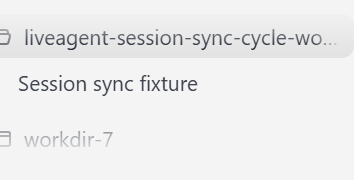
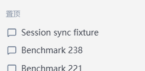

# 真实客户端同步预览

两个截图来自当前任务工作区 BAT 启动的 Tauri，以及连接其 Gateway 的真实 WebUI。测试会话为可丢弃的 `Session sync fixture`，历史为合成数据，没有用户会话、token 或本机绝对目录。使用原生 CDP screenshot clip 直接截取界面区域，没有编辑 DOM 或像素；复制后逐一核对原文件 SHA-256 相同。

截图只说明同一实际 fixture 会话在两端可见。置顶动作在两个截图之间发生，不能用图片证明这两个状态属于同一原子切点；操作与同步正确性由独立 DOM、真实 HTTP、WebSocket 断言和循环记录证明。

桌面：

WebUI：

资源前后数字、真实触发步骤、失败及未覆盖项见上级目录的 `automation.md`、`verification.md`、`relay-compat.md` 与 `progress.md`。
